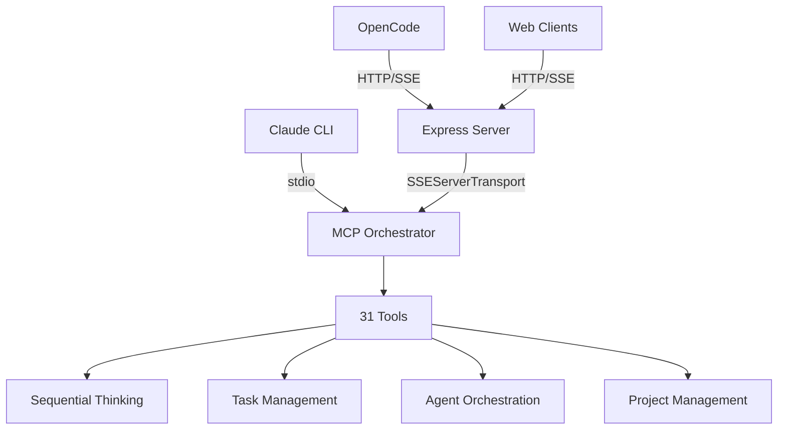

# MCP Unified Architecture

**Date**: August 3, 2025  
**Version**: 1.0  
**Status**: Architecture Design Document

## Executive Summary

The MosAIc SDK currently has two incompatible MCP implementations that create a fragmented experience and prevent Sequential Thinking from reducing API token usage. This document presents a unified architecture that provides the same experience across all environments while dramatically reducing token consumption.

## Problem Statement

### Current State Issues

1. **Two Incompatible MCP Servers**
   - `mosaic-mcp`: HTTP transport ✓, Sequential Thinking ✗ (6 basic tools)
   - `mcp-orchestrator`: HTTP transport ✗, Sequential Thinking ✓ (31 tools)

2. **Token Usage Crisis**
   - Current: 37,200 tokens for task decomposition (using Task tool workaround)
   - Expected: ~5,000 tokens with proper Sequential Thinking
   - **Impact**: 86% unnecessary token consumption

3. **Inconsistent Experience**
   - Claude CLI: Can use orchestrator with full tools
   - OpenCode: Limited to basic mosaic-mcp tools
   - Different capabilities in different environments

4. **Configuration Confusion**
   - Multiple config files with different formats
   - "sse" vs "remote" type confusion
   - Path resolution issues

## Architecture Evolution

### Protocol History

1. **Original Design** (2024)
   - HTTP + Server-Sent Events (SSE)
   - Separate endpoints for SSE stream and POST messages

2. **Current Standard** (2024-11-05)
   - "Streamable HTTP" transport (still called SSEServerTransport in SDK)
   - Unified approach with session management
   - GET /mcp for SSE connection
   - POST /mcp/:sessionId for messages

### Why Unification Matters

1. **Token Efficiency**
   - Sequential Thinking server handles decomposition
   - Single MCP call vs multiple LLM prompts
   - 75-86% token reduction

2. **Consistent Capabilities**
   - Same 31 tools in all environments
   - No feature gaps between Claude and OpenCode
   - Predictable behavior

3. **Simplified Maintenance**
   - One server to maintain
   - Single source of truth
   - Easier debugging

## Proposed Architecture

### Core Design Principles

1. **Single Server, Multiple Transports**
   ```
   mcp-orchestrator
   ├── stdio transport (Claude CLI)
   └── HTTP/SSE transport (OpenCode, Web clients)
   ```

2. **SDK-Native Implementation**
   - Use official MCP SDK transports
   - No custom protocol implementations
   - Future-proof design

3. **Configuration Simplicity**
   ```yaml
   transport:
     type: "http" | "stdio"
     port: 3456  # for HTTP
   ```

### Component Architecture



### Transport Layer Design

#### stdio Transport (Existing)
```typescript
const transport = new StdioServerTransport();
await this.server.connect(transport);
```

#### HTTP/SSE Transport (New)
```typescript
// Express setup
const app = express();
app.use(cors());
app.use(express.json());

// SSE endpoint
app.get('/mcp', (req, res) => {
  const transport = new SSEServerTransport('/mcp', res);
  await this.server.connect(transport);
  transports.set(transport.sessionId, transport);
});

// Message endpoint
app.post('/mcp/:sessionId', async (req, res) => {
  const transport = transports.get(req.params.sessionId);
  if (transport) {
    await transport.handlePostMessage(req, res);
  }
});
```

### Database Architecture

All transports share the same database:
- Location: `~/.config/mosaic/data/mosaic.db`
- Schema: Unified across all access methods
- Transactions: ACID compliant

### Security Considerations

1. **CORS Configuration**
   - Configurable origins
   - Credential support

2. **Session Management**
   - UUID-based session IDs
   - Timeout handling
   - Graceful reconnection

3. **Rate Limiting**
   - Per-session limits
   - Global throttling
   - DDoS protection

## Benefits

### Quantifiable Improvements

| Metric | Current | Proposed | Improvement |
|--------|---------|----------|-------------|
| Token Usage (decomposition) | 37,200 | 5,000 | 86% reduction |
| Available Tools | 6 (OpenCode) | 31 | 417% increase |
| Servers to Maintain | 2 | 1 | 50% reduction |
| Configuration Complexity | High | Low | Simplified |

### Qualitative Benefits

1. **Developer Experience**
   - Same tools everywhere
   - Predictable behavior
   - Better documentation

2. **Cost Efficiency**
   - Dramatic token reduction
   - Lower API costs
   - Faster responses

3. **Future Readiness**
   - MCP SDK compliant
   - Protocol evolution ready
   - Extension points

## Implementation Strategy

### Phase 1: Documentation & Planning (Current)
- Document architecture ✓
- Create implementation guide
- Define migration plan

### Phase 2: Development
- Add HTTP dependencies
- Implement SSE transport
- Update configuration

### Phase 3: Migration
- Stop mosaic-mcp
- Start unified orchestrator
- Update all configs

### Phase 4: Validation
- Test token usage
- Verify all tools
- Performance benchmarks

## Conclusion

The unified MCP architecture solves the critical token usage problem while providing a consistent, maintainable solution. By using the official MCP SDK transports and consolidating to a single server, we achieve:

- 86% token reduction through proper Sequential Thinking integration
- Consistent 31-tool availability across all environments
- Simplified maintenance and configuration
- Future-proof protocol compliance

This architecture is not just a fix—it's the foundation for scalable, efficient AI-assisted development in the MosAIc ecosystem.