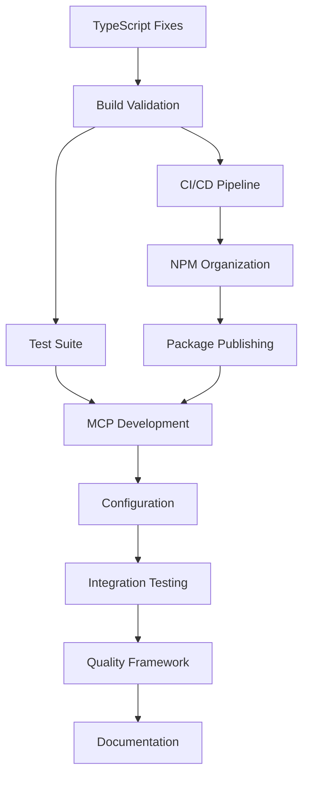

# E.300 Atomic Task List

**Epic**: E.300 - MosAIc SDK Stabilization and Release Preparation  
**Total Atomic Tasks**: 336  
**Estimated Duration**: 168 hours (336 × 30 minutes)  
**Status**: Ready for Execution

## Task Execution Guidelines

### Atomic Task Definition

- **Duration**: ≤30 minutes
- **Scope**: Single, focused action
- **Output**: Verifiable deliverable
- **Dependencies**: Clearly defined

### Task ID Format

```
A.300.FF.SS.TT.ST.AT
│ │   │  │  │  │  └─ Atomic Task (01-99)
│ │   │  │  │  └──── Subtask (01-99)
│ │   │  │  └─────── Task (01-99)
│ │   │  └────────── Story (01-99)
│ │   └───────────── Feature (01-05)
│ └───────────────── Epic (300)
└─────────────────── Atomic indicator
```

## Critical Path Tasks (Must Complete First)

### Day 1: TypeScript Compilation Fix

```
A.300.01.01.01.01.01: Read UniversalProviderRegistry.ts implementation (15 min)
A.300.01.01.01.01.02: Analyze interface vs implementation mismatch (15 min)
A.300.01.01.01.02.01: Update method signatures to match interface (15 min)
A.300.01.01.01.02.02: Ensure all return types align correctly (15 min)
A.300.01.01.01.03.01: Run tsc on providers package (10 min)
A.300.01.01.01.03.02: Run provider package tests (20 min)
A.300.01.01.01.04.01: Check dependent packages for type errors (15 min)
A.300.01.01.01.04.02: Update any affected type definitions (15 min)
```

### Day 1-2: Package Build Validation

```
A.300.01.01.02.01.01: Build @mosaicstack/config (10 min)
A.300.01.01.02.01.02: Build @mosaicstack/providers (10 min)
A.300.01.01.02.01.03: Build @mosaicstack/mcp-common (10 min)
A.300.01.01.02.01.04: Build @mosaicstack/cli (10 min)
A.300.01.01.02.01.05: Build @mosaicstack/stack (10 min)
A.300.01.01.02.01.06: Build remaining packages (10 min)
A.300.01.01.02.02.01: Document each build error found (15 min)
A.300.01.01.02.02.02: Apply fixes for each error (30 min)
A.300.01.01.02.02.03: Re-run builds to verify fixes (15 min)
```

## Feature-Organized Task Lists

### F.300.01: Critical Build Remediation (48 Atomic Tasks)

#### TypeScript Fixes (8 tasks)

- A.300.01.01.01.01.01 through A.300.01.01.01.04.02

#### Build Validation (9 tasks)

- A.300.01.01.02.01.01 through A.300.01.01.02.02.03

#### Test Suite Restoration (12 tasks)

- A.300.01.02.01.01.01 through A.300.01.02.02.02.06

#### CI/CD Pipeline (19 tasks)

- A.300.01.03.01.01.01 through A.300.01.03.02.02.04

### F.300.02: NPM Publishing (36 Atomic Tasks)

#### Organization Setup (6 tasks)

- A.300.02.01.01.01.01 through A.300.02.01.01.02.02

#### Package Configuration (15 tasks)

- A.300.02.01.02.01.01 through A.300.02.01.02.03.03

#### Publishing Pipeline (15 tasks)

- A.300.02.02.01.01.01 through A.300.02.03.02.02.04

### F.300.03: E.200 Integration (96 Atomic Tasks)

#### MCP Orchestrator Package (48 tasks)

- A.300.03.01.01.01.01 through A.300.03.01.03.02.08

#### Configuration Integration (32 tasks)

- A.300.03.02.01.01.01 through A.300.03.02.03.02.08

#### Documentation (16 tasks)

- A.300.03.03.01.01.01 through A.300.03.03.02.02.04

### F.300.04: Quality Framework (80 Atomic Tasks)

#### Test Infrastructure (24 tasks)

- A.300.04.01.01.01.01 through A.300.04.01.02.02.08

#### Security Testing (32 tasks)

- A.300.04.02.01.01.01 through A.300.04.02.02.02.08

#### Documentation (24 tasks)

- A.300.04.03.01.01.01 through A.300.04.03.02.02.04

### F.300.05: Documentation & DevEx (76 Atomic Tasks)

#### Documentation Consolidation (24 tasks)

- A.300.05.01.01.01.01 through A.300.05.01.02.02.08

#### Developer Experience (32 tasks)

- A.300.05.02.01.01.01 through A.300.05.02.02.02.08

#### API Documentation (20 tasks)

- A.300.05.03.01.01.01 through A.300.05.03.02.02.04

## Execution Tracking Template

```markdown
## Task: [Task ID]

**Started**: [ISO Timestamp]
**Completed**: [ISO Timestamp]
**Duration**: [Actual minutes]
**Agent**: [Agent Name]

### Deliverable

[What was produced]

### Notes

[Any relevant information]

### Blockers

[Any issues encountered]
```

## Daily Task Allocation

### Day 1 (16 tasks)

- Morning: TypeScript fixes (8 tasks) - Benjamin
- Afternoon: Build validation start (8 tasks) - Benjamin

### Day 2 (16 tasks)

- Morning: Complete builds (8 tasks) - Benjamin
- Afternoon: Test fixes (8 tasks) - Tara

### Day 3 (16 tasks)

- Morning: Test coverage (8 tasks) - Tara
- Afternoon: CI/CD fixes (8 tasks) - Benjamin

### Day 4 (16 tasks)

- Morning: NPM org setup (8 tasks) - Oliver
- Afternoon: Package config (8 tasks) - Oliver

### Day 5 (16 tasks)

- Morning: Publishing pipeline (8 tasks) - Oliver
- Afternoon: Initial publish (8 tasks) - Oliver/Sarah

### Days 6-19 (96 tasks)

- MCP development (48 tasks) - Benjamin
- Configuration work (32 tasks) - Felix
- Documentation (16 tasks) - Benjamin/Felix

### Days 20-26 (80 tasks)

- Test framework (24 tasks) - Quinn/Tara
- Security setup (32 tasks) - Sarah
- Quality docs (24 tasks) - Quinn

### Days 27-33 (76 tasks)

- Doc consolidation (24 tasks) - David
- DevEx improvements (32 tasks) - David/Ursula
- API docs (20 tasks) - David

## Task Dependencies Graph



## Success Criteria Per Task

Each atomic task must:

1. Complete within 30 minutes
2. Produce verifiable output
3. Pass quality checks
4. Be documented in context file
5. Update progress tracking

## Risk Mitigation for Tasks

### Common Risks

1. **Task Overrun**: Break into smaller atomics
2. **Dependency Block**: Identify early, escalate
3. **Technical Complexity**: Pair programming
4. **Missing Context**: Document thoroughly

### Mitigation Strategies

- Daily task review
- Blocker identification
- Pair assignments for complex tasks
- Regular sync points

## Task Completion Checklist

For each atomic task:

- [ ] Task started on time
- [ ] Clear understanding of deliverable
- [ ] Dependencies available
- [ ] Work completed
- [ ] Output verified
- [ ] Documentation updated
- [ ] Next task identified
- [ ] Handoff completed (if needed)

## Metrics and Reporting

### Daily Metrics

- Tasks planned vs completed
- Average task duration
- Blocker count
- Velocity trend

### Weekly Rollup

- Feature progress percentage
- Agent utilization
- Quality metrics
- Risk assessment

## Conclusion

This atomic task list provides:

- **336 discrete tasks** each ≤30 minutes
- **Clear dependencies** and sequencing
- **Agent assignments** for optimal flow
- **Tracking mechanisms** for progress
- **Risk mitigation** strategies

Execute tasks in order, track meticulously, and escalate blockers immediately for epic success.

---

**Document Version**: 1.0.0  
**Last Updated**: 2025-07-22  
**Task List Status**: Complete and Ready for Execution
