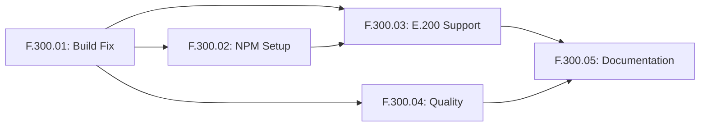

# E.300 Feature Breakdown: MosAIc SDK Stabilization

**Epic**: E.300 - MosAIc SDK Stabilization and Release Preparation  
**Status**: Planning Complete  
**Created**: 2025-07-22  
**Duration**: 7 weeks (33 working days)

## Feature Overview

This document provides the feature-level breakdown for Epic E.300, focusing on stabilizing the MosAIc SDK and preparing it for public release.

## Feature Summary

| ID       | Feature                         | Priority | Duration | Lead Agent               | Status  |
| -------- | ------------------------------- | -------- | -------- | ------------------------ | ------- |
| F.300.01 | Critical Build Remediation      | CRITICAL | 3 days   | BE-BACKEND-BENJAMIN      | Planned |
| F.300.02 | NPM Organization and Publishing | HIGH     | 2 days   | DEVOPS-OPERATIONS-OLIVER | Planned |
| F.300.03 | E.200 Integration Support       | HIGH     | 2 weeks  | BE-BACKEND-BENJAMIN      | Planned |
| F.300.04 | Quality Assurance Framework     | MEDIUM   | 1 week   | QA-QUALITY-QUINN         | Planned |
| F.300.05 | Documentation and DevEx         | MEDIUM   | 1 week   | DOC-DOCUMENTATION-DAVID  | Planned |

## Critical Path Dependencies

## F.300.01: Critical Build Remediation

**Priority**: CRITICAL - Blocks all other work  
**Duration**: 3 days  
**Lead**: BE-BACKEND-BENJAMIN  
**Support**: TEST-AUTOMATION-TARA

### Objectives

- Fix TypeScript compilation errors in provider package
- Restore full test suite functionality
- Repair CI/CD pipeline for automated builds

### Key Deliverables

1. All packages compile without errors
2. Test suite passes with >80% coverage
3. GitHub Actions workflows functional
4. Build performance optimized

### Success Criteria

- ✅ Zero TypeScript errors
- ✅ All tests passing
- ✅ CI/CD pipeline green
- ✅ Build time <5 minutes

## F.300.02: NPM Organization and Publishing Infrastructure

**Priority**: HIGH - Enables distribution  
**Duration**: 2 days  
**Lead**: DEVOPS-OPERATIONS-OLIVER  
**Support**: SEC-SECURITY-SARAH

### Objectives

- Create @mosaicstack NPM organization
- Configure automated publishing pipeline
- Establish version management strategy
- Secure publishing process

### Key Deliverables

1. NPM organization created and configured
2. All package namespaces reserved
3. Automated release workflow
4. Security measures implemented

### Success Criteria

- ✅ @mosaicstack organization active
- ✅ Packages publishable via CI/CD
- ✅ Version management automated
- ✅ 2FA and signing configured

## F.300.03: E.200 Integration Support

**Priority**: HIGH - Unblocks E.200 team  
**Duration**: 2 weeks  
**Lead**: BE-BACKEND-BENJAMIN  
**Support**: FS-FULLSTACK-FELIX

### Objectives

- Develop @mosaicstack/mcp-orchestrator package
- Create OpenCode configuration integration
- Implement task synchronization
- Provide comprehensive documentation

### Key Deliverables

1. MCP server implementation
2. MosAIc-specific MCP tools
3. Configuration system for OpenCode
4. Integration documentation and examples

### Success Criteria

- ✅ MCP server functional
- ✅ All MosAIc tools working
- ✅ Task sync operational
- ✅ E.200 team unblocked

## F.300.04: Quality Assurance and Testing Framework

**Priority**: MEDIUM - Ensures stability  
**Duration**: 1 week  
**Lead**: QA-QUALITY-QUINN  
**Support**: TEST-AUTOMATION-TARA, SEC-SECURITY-SARAH

### Objectives

- Standardize testing across all packages
- Implement security scanning
- Add performance testing
- Create quality documentation

### Key Deliverables

1. Unified test framework
2. Security scanning pipeline
3. Performance benchmarks
4. Quality metrics dashboard

### Success Criteria

- ✅ Test standards documented
- ✅ Security scanning automated
- ✅ Performance baselines set
- ✅ Quality gates enforced

## F.300.05: Documentation and Developer Experience

**Priority**: MEDIUM - Improves adoption  
**Duration**: 1 week  
**Lead**: DOC-DOCUMENTATION-DAVID  
**Support**: UX-EXPERIENCE-URSULA

### Objectives

- Consolidate fragmented documentation
- Improve developer onboarding
- Generate API documentation
- Create documentation website

### Key Deliverables

1. Unified documentation structure
2. Quick start guide
3. API reference (auto-generated)
4. Documentation portal

### Success Criteria

- ✅ Single source of truth
- ✅ 5-minute quick start
- ✅ 100% API coverage
- ✅ Searchable doc site

## Resource Allocation

### Agent Availability Matrix

| Agent                    | F.01        | F.02        | F.03         | F.04        | F.05        | Total Days |
| ------------------------ | ----------- | ----------- | ------------ | ----------- | ----------- | ---------- |
| BE-BACKEND-BENJAMIN      | Lead (3)    | -           | Lead (10)    | -           | -           | 13         |
| DEVOPS-OPERATIONS-OLIVER | -           | Lead (2)    | -            | -           | -           | 2          |
| QA-QUALITY-QUINN         | -           | -           | -            | Lead (5)    | -           | 5          |
| DOC-DOCUMENTATION-DAVID  | -           | -           | -            | -           | Lead (5)    | 5          |
| TEST-AUTOMATION-TARA     | Support (3) | -           | -            | Support (5) | -           | 8          |
| SEC-SECURITY-SARAH       | -           | Support (2) | -            | Support (3) | -           | 5          |
| FS-FULLSTACK-FELIX       | -           | -           | Support (10) | -           | -           | 10         |
| UX-EXPERIENCE-URSULA     | -           | -           | -            | -           | Support (5) | 5          |

### Concurrent Work Streams

**Week 1**: F.300.01 (Critical fixes)
**Week 2**: F.300.02 + F.300.03 start
**Weeks 3-4**: F.300.03 continues + F.300.04
**Week 5**: F.300.05 + F.300.03 completion

## Risk Register

| Risk                      | Impact | Probability | Mitigation                     |
| ------------------------- | ------ | ----------- | ------------------------------ |
| TypeScript fix complexity | HIGH   | MEDIUM      | Incremental fixes with testing |
| NPM org unavailable       | MEDIUM | LOW         | Alternative names prepared     |
| E.200 integration delays  | HIGH   | MEDIUM      | Early prototype delivery       |
| Coverage target missed    | MEDIUM | MEDIUM      | Focus on critical paths        |
| Documentation scope creep | LOW    | HIGH        | Strict scope definition        |

## Communication Plan

### Daily Syncs

- **09:00**: Feature lead standup
- **13:00**: Cross-feature coordination
- **17:00**: Progress and handoffs

### Weekly Reviews

- **Monday**: Week planning and priority alignment
- **Wednesday**: Mid-week checkpoint
- **Friday**: Week retrospective and planning

### Escalation Path

1. Feature Lead → Epic Lead (Tony)
2. Epic Lead → Technical Architect (Alex)
3. Technical Architect → Project Sponsor

## Quality Gates

Each feature must pass these gates before completion:

### Code Quality

- [ ] TypeScript strict mode compliance
- [ ] ESLint zero errors
- [ ] > 80% test coverage
- [ ] Performance benchmarks met

### Documentation

- [ ] API documentation complete
- [ ] User guides written
- [ ] Examples provided
- [ ] Changelog updated

### Security

- [ ] No high/critical vulnerabilities
- [ ] Dependencies audited
- [ ] Licenses verified
- [ ] Security review passed

### Release Readiness

- [ ] All tests passing
- [ ] Documentation complete
- [ ] Performance validated
- [ ] Stakeholder approval

## Next Steps

1. **Immediate**: Begin F.300.01 build remediation
2. **Day 2**: Start TypeScript fixes with Benjamin
3. **Day 4**: Begin F.300.02 NPM setup with Oliver
4. **Week 2**: Launch F.300.03 MCP development
5. **Ongoing**: Daily progress tracking and coordination

---

**Document Version**: 1.0.0  
**Last Updated**: 2025-07-22  
**Next Review**: 2025-07-25
